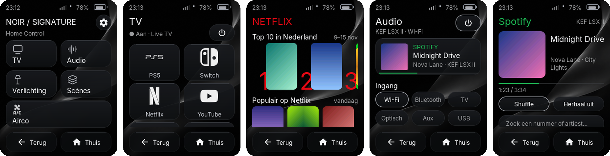
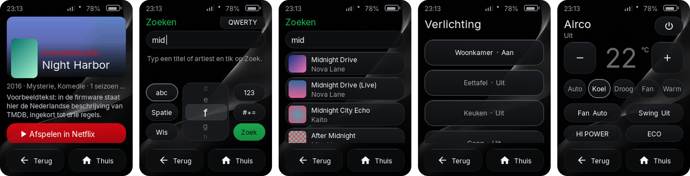

<h1 align="center">NOIR / SIGNATURE</h1>

<p align="center"><b>A dark, minimal home-control UI for the OpenRemote Rev6, running on ESPHome and Home Assistant.</b><br>
TV, Netflix, KEF audio with Spotify, lights, scenes and air conditioning – driven by the touch screen <i>and</i> the physical keys.</p>

<p align="center"></p>
<p align="center"></p>
<p align="center"><sub>Screenshots from the NOIR simulator (LVGL 9, 240 × 320). Titles and artwork are placeholders. The UI language is Dutch.</sub></p>

## What's inside

| Screen | What it does |
|---|---|
| **Home** | Large tiles for TV, Audio, Lights, Scenes and Airco, plus a status bar with clock, Wi-Fi bars, HA status and battery. |
| **TV** | LG webOS: power, app/source tiles (PS5, Switch, Netflix, YouTube, IPTV, Plex). The D-pad, OK, Back and Home keys control the TV. |
| **Netflix** | Official weekly Top 10 for the Netherlands, *Popular on Netflix* and *Recently started*, all with posters (TMDB). A detail screen with a **Play** button opens the title directly on the TV. Play/pause and seek use the physical keys. |
| **Audio** | KEF LSX II: power, inputs (Wi-Fi, Bluetooth, TV, Optical, Aux, USB), volume and **subwoofer level**. The volume keys always control the KEF. |
| **Spotify** | Now playing with album art and progress, shuffle/repeat, your playlists, recently played, Spotify Connect device picker and **search** (letter wheel or QWERTY). |
| **Lights & Scenes** | Lights from the configurator, with tap to toggle and hold to dim. Scenes, plus a built-in *All off*. |
| **Airco** | Mitsubishi Heavy Industries over IR (temperature, mode, fan, swing, HI POWER, ECO). |
| **Settings** | Four skins, wallpapers and corner radius. |

**Reliability:** a Wi-Fi watchdog restarts the remote if Wi-Fi does not come back. Hold the power key for 3 seconds to get the shut-down prompt.

## Setup (short)

1. Install the `esphomeremote` integration in Home Assistant (HACS → custom repository → this repo).
2. Build the firmware for the Rev6 with ESPHome and set the NOIR substitutions:

   ```yaml
   substitutions:
     noir_kef_entity: media_player.your_kef
     noir_kef_sub:    number.your_kef_sub_gain
     noir_spotify:    media_player.spotify_you
   ```
3. Optional: add a TMDB API key in the integration options for Netflix posters.

More details: [docs/noir.md](docs/noir.md).

## Simulator

All NOIR screens run on a PC (SDL2 + LVGL 9.5). Mouse = finger, arrow keys/Enter/Backspace = D-pad/OK/Back. `--demo` saves a screenshot of every screen.

## Credits

NOIR is built on **[ESPHomeRemote by Aggro600](https://github.com/Aggro600/ESPHomeRemote)**, which provides the firmware base, the configurator and the dock. Hardware: [OpenRemote Rev6](https://github.com/LORDSn1per/OpenRemote-Hardware). Font: Inter (OFL). Icons: Material Design Icons, Lucide, Simple Icons.

License: MIT (see [LICENSE](LICENSE)).
