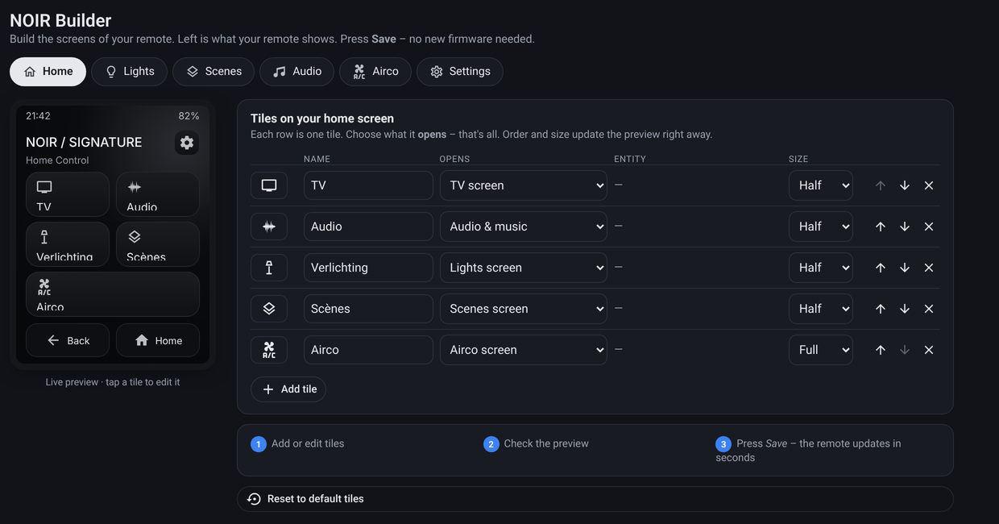

# NOIR – how it works

NOIR is a set of touch screens for the OpenRemote Rev6. You set it up in **three steps**:

| Step | Where | Once or often? |
|---|---|---|
| **1. Flash the firmware** | ESPHome | Once (and for updates) |
| **2. Install the integration** | Home Assistant → HACS | Once |
| **3. Build your screens** | Home Assistant → ESPHomeRemote → **NOIR Builder** | As often as you like – no new firmware |

<p align="center"></p>

---

## 1. Firmware

Build the Rev6 firmware with ESPHome. Only these lines matter for NOIR:

```yaml
substitutions:
  noir_aan: "true"                  # "false" = the normal ESPHomeRemote home page
  noir_tv_entity: media_player.your_lg_tv
  noir_tv_activiteit: "TV"          # name of your TV activity in the configurator
```

Everything else (lights, scenes, audio) can be set in the NOIR Builder.

In Home Assistant, turn on **"Allow the device to perform Home Assistant actions"** for the remote
(Settings → Devices → ESPHome → your remote). Without it the remote can't switch anything.

## 2. Integration

HACS → ⋮ → Custom repositories → `https://github.com/ronsone/ESPHomeRemote` (type *Integration*) → install
**ESPHomeRemote** → restart Home Assistant → add the integration.

Optional: a free **TMDB key** (Settings → Devices & services → ESPHomeRemote → Configure) gives Netflix posters.

## 3. NOIR Builder

Open **ESPHomeRemote** in the Home Assistant sidebar, pick your remote, open **NOIR Builder**.
Left is a live preview of the remote. Right are simple rows. Press **Save** when done.

| Tab | What you set |
|---|---|
| **Home** | The tiles on the home screen. Per tile: icon, name, what it **opens**, size (half / full). |
| **Lights** | The lights on the Lights screen: name, entity, dimmable. *All off* uses this list. |
| **Scenes** | Tiles on the Scenes screen. Each runs a `scene.…` or `script.…`. *All off* is always there. |
| **Audio** | Speaker (e.g. KEF), subwoofer level and your Music Assistant player. |
| **Airco** | Nothing needed. Fine-tuning for the infrared code is folded away. |
| **Settings** | Netflix info and *Advanced*: open any NOIR screen in the full menu editor. |

### What a tile can open

| Opens | Does |
|---|---|
| TV screen | Starts your TV activity and shows the TV screen |
| Audio & music | Speaker, inputs, volume, sub, playlists, search |
| Lights / Scenes / Airco screen | Opens that screen |
| Netflix | Top 10, popular, recently started |
| Remote settings | Skin, wallpaper, corner radius |
| Toggle an entity | Switches a light or switch on/off |
| Run a scene or script | Starts a Home Assistant scene or script |
| Advanced (steps) | Your own steps: IR codes, HA actions, waits … (menu editor) |

The Builder places tiles by itself: two half tiles side by side, a full tile on its own row.

---

## The screens

| Screen | Touch | Keys |
|---|---|---|
| **Home** | Tap a tile | D-pad + OK |
| **TV** | Power, apps and sources | D-pad, OK, Back, Home go to the TV |
| **Netflix** | Tap a poster → details → *Play* | Play/pause, seek |
| **Audio** | Power, input, volume, sub; tap *now playing* → music | Volume keys always control the speaker |
| **Music** | Playlists, recent, devices, search (letter wheel or keyboard) | Play/pause, next/previous |
| **Lights** | Tap = on/off, hold = dim | – |
| **Scenes** | Tap a scene | – |
| **Airco** | Temperature, mode, fan, swing, HI POWER, ECO | – |

**Power key:** hold 3 seconds for the shut-down prompt.
**Wi-Fi:** bars in the status bar. Lost Wi-Fi? *Settings → Restore Wi-Fi*. After 4 minutes without Wi-Fi the remote restarts by itself.

---

## Music: Music Assistant

All music goes through **Music Assistant** (MA). Spotify, radio, your own files … are sources *inside* MA.

1. Install Music Assistant in Home Assistant (Settings → Devices & services → Add integration → Music Assistant;
   choose the official app). Add your music sources and enable a player provider for your speaker (e.g. Chromecast).
2. NOIR Builder → **Audio → Music**: pick the MA player of your speaker. Only MA players are listed.
3. On the remote: Audio → *Muziek* shows playlists, recently played and search. Tap = play on that player.

**Separate networks (VLANs)?** MA must reach the speaker, and the speaker fetches the stream from MA:
allow HA → speaker (Chromecast TCP 8009) and speaker → HA (TCP 8097), and repeat mDNS between the networks.

## Optional YAML fallbacks

If you don't use the Builder for a screen, these substitutions still work:

```yaml
  noir_kef_entity: media_player.your_speaker
  noir_kef_sub:    number.your_sub_gain
  noir_muziek:     media_player.your_ma_player     # Music Assistant player
  noir_lampen:     "Living=light.living|Kitchen=switch.kitchen"
  noir_tv_script:  script.tv_source
  noir_tv_bronnen: "PS5|HDMI 2|Netflix|YouTube|IPTV|Plex"
```

What you set in the Builder always wins over the YAML.

## Network

The remote only talks to Home Assistant (port 8123). Posters, covers and lists come from the integration,
so the remote never needs the internet itself. Home Assistant needs access to `api.themoviedb.org`,
`image.tmdb.org`, `www.netflix.com` and Music Assistant.

<sub>This product uses the TMDB API but is not endorsed or certified by TMDB.</sub>
